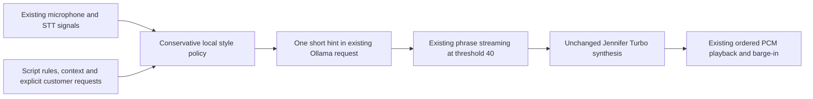

# Jennifer conversational prosody: feasibility and minimal A/B plan

Research review, 3 November2026 (Asia/Karachi). **No inference, installation, service request, restart, production change or deployment was performed.** Transport investigation remains documented in `docs/http-client-isolation-review.md`; no transport code was edited. VoiceStreaming,40-character first-clause policy, VAD, barge-in, recording, voice reference and approved generation settings remain unchanged.

## Decision

Start with **context-aware phrasing in the existing Ollama call**, not an emotion slider or a second inference pipeline. This can improve perceived warmth and clarity while keeping Jennifer's identity; acoustic effects are hypotheses requiring listening tests. The current text-only Turbo endpoint does not provide dependable named emotion, pitch, rate or pause-duration controls.

Warm, neutral, reassuring and serious should initially be **dialogue-style intents**, not claims that the TTS engine has four controllable emotional voices. If the entire answer is required verbatim and no text/punctuation changes are allowed, the unchanged current API cannot reliably produce four distinct acoustic modes on demand. There must be an allowed flexible wording region, or a later independently validated TTS capability; never silently loosen script requirements.

Lissa's recording was not attached and no Lissa-named file was found in the checked Downloads location. No reference listening, transcript, rate statistics or similarity evaluation of Lissa was performed. When supplied, use it only to evaluate conversational behavior (turn-taking, clarity, warmth, pacing), never as speaker conditioning, a voice embedding, training material or a pitch/accent target.

## What is actually supported

Read-only inspection covered the physical `chatterbox_voice_server.py`, installed Turbo source at `C:\Shahvex-AI\chatterbox-testing\.venv\Lib\site-packages\chatterbox\tts_turbo.py`, and the existing Gateway. Inspected distribution version:0.1.7; source SHA256 `19b531951f0ea68102327f379b2b9eb986d37d4a3eae30ef58716c7d61abf98e`.

The wrapper reads `text` and invokes `MODEL.generate(text.strip())` using the prepared Jennifer reference. It does not forward emotion, speed or sampling fields from JSON. Extra JSON keys can therefore be ignored without producing an error; HTTP200 would not prove a control works. Exact live-loaded module revision was not attested; starting a fresh base-Python metadata process did not resolve its package, while the known TTS venv source was inspectable. Executable path alone is insufficient to establish a virtual environment. No service was introspected or changed to resolve that uncertainty.

| Control | Turbo implementation | Current Shahvex API | Recommendation |
|---|---|---|---|
| Wording and ordinary punctuation | Text-driven cues | Available through `text` | First experiment; delivery is not deterministic |
| Warm/reassuring/serious labels | No named delivery parameter found | Not exposed | Keep labels in controller context, never speak them |
| Exact speaking rate, pitch, pause milliseconds | No such generate parameters found | Not exposed | Do not invent controls or use SSML |
| `exaggeration`, `cfg_weight`, `min_p` | Explicitly unsupported/ignored by inspected Turbo | Not forwarded | Leave unchanged; not emotion knobs |
| `temperature`, `top_p`, `top_k`, `repetition_penalty` | Passed to token sampling | Not forwarded | Randomness controls, not reliable emotions; keep current values |
| Reference conditioning | Establishes speaker conditioning | Prepared once | Preserve exact reference and preparation |
| `norm_loudness` | Reference preparation behavior | Not forwarded | Not a per-phrase warmth/volume control |
| Non-speech event tags | Some documented native events | Text can carry tags | Optional separate test only; exclude from initial controller |

The installed architecture disables emotion conditioning, and the current upstream Turbo implementation agrees about ignored emotion/CFG controls. Do not apply original-Chatterbox tuning advice to Turbo. Its punctuation cleanup also collapses whitespace and normalizes some punctuation; repeated newlines/ellipsis do not specify precise pause durations. Source: [official Turbo implementation](https://github.com/resemble-ai/chatterbox/blob/master/src/chatterbox/tts_turbo.py).

Official Turbo documentation describes event tags such as `[laugh]`, `[chuckle]` and `[cough]`. Its demo also lists events including sighing and gasping; these are sounds, not dependable reassurance/seriousness directives. No documented `[warm]`, `[reassuring]`, `[serious]` or timed pause control was established. Arbitrary bracketed directions or SSML could be spoken literally or behave unpredictably. Sources: [Turbo model card](https://huggingface.co/ResembleAI/chatterbox-turbo), [official Turbo demo source](https://github.com/resemble-ai/chatterbox/blob/master/gradio_tts_turbo_app.py).

The model card contains a section explicitly about **original Chatterbox**; its CFG/exaggeration advice should not override the Turbo-specific code. Hosted-service marketing latency also does not establish local RTX4060 performance. No model switch, altered reference, per-phrase reconditioning, sampling adjustment, pitch shift, playback-rate change or time stretching is proposed.

## Lightweight controller design — proposal only

Use available signals, not a new speech-emotion model. Explicit requests such as asking for clarification are stronger evidence than loudness or speaking speed. Optional low-cost features can be accumulated during existing microphone processing: voiced-frame proportion, clipping/noise indicators, interruptions and rough speaking rate from existing STT and voiced-duration estimates. Those exact features are not all currently exported; adding them would require a separately approved implementation. Do not change VAD or wait for extra silence to collect them.

RMS is not emotion, pauses can reflect thinking or system delay, and overlap can be Jennifer's playback rather than the customer's state. Ignore acoustic evidence when clipping, overlap, echo, very short speech or uncertain transcription makes it unreliable. Do not target the customer's pitch/accent, infer demographic/personality traits or construct a persistent emotional profile.

| Style intent | Strong reason to select it | LLM-level delivery guidance |
|---|---|---|
| Neutral, default | Uncertain/no clear contextual need | Clear, respectful, direct wording |
| Warm | Greeting or clearly cooperative engagement | Friendly optional wording; no exaggerated enthusiasm or forced laughter |
| Reassuring | Explicit confusion/concern or repeat request | Acknowledge the stated issue and clarify provided facts; no invented guarantees |
| Serious | Script-critical condition, consent, refusal or sensitive factual clarification | Plain, unambiguous wording; no jokes or cheerful minimization |

These labels guide wording, not psychological diagnoses. Script obligations and response intent outrank acoustic hints. Explicit customer instructions can take effect on the next turn; weak acoustic cues alone should require consistent evidence over at least two valid turns. Use qualitative evidence tiers until calibrated data exist, not invented emotion-confidence percentages. Default to neutral on conflict, and keep changes small.

Choose one style per response and freeze it for all its phrases. Store only per-call state; delete it with the session. A barge-in cancels old-generation audio/style work through the existing machinery; the next turn may select a new intent. Never recolor queued PCM, resynthesize earlier phrases or overlap native TTS jobs.

## Content and latency safeguards

- Mandatory script spans, disclosures, names, numbers, conditions and provided facts remain locked. Style applies only to approved optional language. If safe variation is unavailable, use the original response. Do not add invented empathy claims, promises, human impersonation, jokes, filler or extra questions that change workflow.
- Apply a short style hint in the **existing** LLM request, subordinate to script rules and after the stable script/prompt prefix where practical. Do not run a second LLM to classify/rewrite the reply or add a new GPU model. Do not require the streamed response to begin with a JSON style block before speech.
- Keep the40-character clause policy and ordered playback unchanged. Different allowed wording can still change first-phrase length/availability; record that as a latency effect rather than attributing it to TTS emotion control.
- Do not add initial buffering or artificial silence. Punctuation can influence delivery indirectly, but cannot fix missing audio or guarantee a rate. A request to speak slowly can be answered with clearer optional wording; acoustic slowing is not guaranteed by this API.
- The local rule engine should have a small budget (proposed <=5ms, not measured). Additional prompt tokens, changed prefix caching, longer wording and extra phrase boundaries can still worsen latency. No zero-cost claim is made.

## Minimal offline demonstration plan

Nothing is generated now. After explicit approval of a quiet test window, use the existing engine/reference/settings and local synthetic scenarios; no live call, production controller or deployment is required for the demonstration.

**Stage1: phrasing first.** Five situations: greeting/warm, factual request/neutral, explicit confusion/reassuring, stated concern/reassuring, mandatory condition/serious. Define the same facts and exact mandatory spans for both variants. A is current LLM instruction; B adds the short conservative style hint to the same `shahvex-natural` call. Keep sampling and history policy fixed. Three repeats per scenario/variant,30 utterances in randomized order. Do not change native RNG settings to engineer favorable voices. Content review occurs on synthetic generated samples before synthesis; this offline review is not an extra live inference stage.

This is a paired **semantic-content** comparison, not identical spoken text. Audit every mandatory span exactly and every factual proposition for equivalence; reject unsupported additions. Avoid artificially shortening B. Track word count and first-phrase characters so length effects remain visible. Use the unchanged40-character splitter and same sequential TTS API for both. A small identical-text repeated control can estimate native stochastic variation separately.

**Stage2, only if needed:** compare authorized punctuation variants outside locked spans. Keep the words fixed and inspect the model's normalization first. This measures indirect text cues, not newly discovered emotion/rate parameters. Do not test ignored JSON knobs or alter sampling/reference settings. Non-speech tags, if requested later, are a separate opt-in demonstration with human suitability review, never a default reassurance mechanism.

Transport remains a confounder: record every integrity failure, do not accept partial audio or silently retry, and do not score clipped samples as proof of poor prosody. A test window and integrity-safe capture need approval; this proposal neither changes transport nor certifies that issue fixed.

## Measures and acceptance

| Dimension | Measure |
|---|---|
| Content | Exact required-span audit, factual equivalence and full utterance/word-order review |
| Naturalness | Blind A/B preference plus1-5 ratings for rhythm, context appropriateness, intelligibility and warmth |
| Identity | Human comparison with approved Jennifer samples for speaker identity/accent; do not compare speaker embeddings to Lissa |
| Acoustic pacing | Output duration, articulation/voiced rate separately from pauses, boundary-gap distribution, loudness/clipping; optional offline F0 diagnostics if already available |
| Timing | Controller time, STT completion, LLM first token/phrase, first valid PCM, scheduled/device output, recorded audible onset, total reply and gaps |
| Reliability | All errors/cancellations, stale-audio checks, no native overlap, cleanup and recording integrity |

Do not conflate user silence, synthesis waits and expressive pauses. Pitch statistics diagnose abrupt jumps; they are not targets for transformation. Use multiple blind listeners, ideally the client and two others, without telling them the desired winner. Treat30 utterances as a pilot; report raw paired ratings and variability, not population certainty.

Proposed gates, not results: zero mandatory-word/fact omissions, unchanged perceived Jennifer identity/accent, a clear preference for B, no increase in transport/cancellation failures, and no material worsening of pauses or first-audio timing. A possible initial latency noninferiority budget is p50 no more than100ms worse and p95 no more than150ms worse than A; agree it before running and report small-sample uncertainty. Do not loosen it afterward to force acceptance.

No perceptual or latency benchmark was run for this investigation. Current measured delay remains above target; this design is for appropriateness/naturalness, not a promise of faster synthesis or two-second replies. First obtain evidence that the one-call phrasing variant helps. Only then consider any separately approved TTS capability work.

## Scope and next decision

Only this research document was added. Existing services, transport investigation/code, models, reference audio, generation settings, dynamic/approved scripts, database, UI and deployment packages are unchanged. No emotion classifier, adapter, runtime API field or feature flag was implemented. A future implementation requires separate review/approval and can initially be an offline prompt/fixture comparison using the unchanged Jennifer engine.
